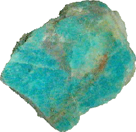

# Amazonite: Characteristics and Effects

## Overview

Amazonite is an opaque green, blue-green, or turquoise variety of [[Microcline]], a member of the [[Feldspar]] group. It may show white spots, streaks, layering, and a subtle glitter. The older Dutch name `amazonesteen` sits beside the modern name, even though the [[Amazon River]] connection rests on an old mistaken attribution rather than an actual Amazon locality.

The stone is scientifically interesting because its color is not just a simple body color. The primary source links it to included [[Copper]] and especially [[Lead]], plus internal structure; external sources also support [[Lead]]-related explanations for amazonite color. Its chemistry is close enough to [[Moonstone]] to invite comparison, but its triclinic crystal system sets it apart from [[Moonstone|moonstone]]'s monoclinic framing in the source material.

Historically, amazonite moves from [[Neolithic]] beads and [[Ancient Egypt|Egyptian]] scarabs to [[Tutankhamun]], [[Alexander von Humboldt|Humboldt]]'s disputed Amazon material, [[Johann Friedrich August Breithaupt|Breithaupt]]'s naming history, [[Indigenous Peoples of the Americas|Indigenous American]] healing-stone traditions, and [[Suffragette]] symbolism. In gemstone therapy it is treated as regenerative, skin-supportive, intellectually curious, and emotionally balancing.

The [[#Composition|composition]] is the most valuable checkpoint: K[AlSi3O8] + Cu, Na, Pb in the primary-source notation, cross-checked against [[Microcline]] formula KAlSi3O8.

The [[#Appearance|appearance]] is easiest to approach through green-blue opacity, white streaking, glitter, and quality differences in tumbled stones.

Graph links worth following: [[Microcline]], [[Feldspar]], [[Alkali Feldspar]], [[Lead]], [[Copper]], [[Moonstone]], and [[Pegmatite]].

## Table Of Contents

- [[#Overview]]
- [[#Lead Image]]
- [[#Key Identity]]
- [[#Composition]]
- [[#Appearance]]
- [[#Geology And Occurrence]]
- [[#Varieties Trade Names And Lookalikes]]
- [[#Name Origin]]
- [[#History And Cultural Use]]
- [[#Energetic And Therapeutic Traditions]]
- [[#Runes And Symbolic Associations]]
- [[#Zodiac Signs]]
- [[#Did You Know]]
- [[#Images]]
- [[#Sources]]
- [[#Validation Notes]]
- [[#Source Notes]]

## Lead Image

| [[gemstone-dictionary#Field\|Field]] | [[gemstone-dictionary#Value\|Value]] |
|---|---|
| [[gemstone-dictionary#Image URL\|Image URL]] | https://www.semoea.nl/images/stories/amazoniet-gepolijst.gif |
| [[gemstone-dictionary#Alt Text\|Alt text]] | ruwe amazoniet |
| [[gemstone-dictionary#Caption\|Caption]] | Ruwe amazoniet, gepolijst vlak |

## Key Identity

| [[gemstone-dictionary#Field\|Field]] | [[gemstone-dictionary#Value\|Value]] |
|---|---|
| [[gemstone-dictionary#Dutch Name\|Dutch name]] | Amazoniet |
| [[gemstone-dictionary#English Name\|English name]] | Amazonite |
| [[gemstone-dictionary#Scientific Name / Mineral Species\|Scientific name / mineral species]] | [[Microcline]] |
| [[gemstone-dictionary#Gemstone Variety Of\|Gemstone variety of]] | [[Microcline]] / [[Alkali Feldspar]] |
| [[gemstone-dictionary#Mineral Group / Family\|Mineral group / family]] | [[Feldspar]] |
| [[gemstone-dictionary#Chemical Class\|Chemical class]] | [[Tectosilicate]] |
| [[gemstone-dictionary#Related Stones\|Related stones]] | [[Moonstone]], [[Labradorite]], [[Microcline]], [[Feldspar]] |
| [[gemstone-dictionary#Primary Source\|Primary source]] | [Semoea page](https://www.semoea.nl/edelstenen/amazoniet.html) |

## Composition

| [[gemstone-dictionary#Field\|Field]] | [[gemstone-dictionary#Value\|Value]] |
|---|---|
| [[gemstone-dictionary#Source Notation\|Source notation]] | K[AlSi3O8] + Cu, Na, Pb |
| [[gemstone-dictionary#Normalized Markdown Notation\|Normalized Markdown notation]] | K[AlSi3O8] + [[Copper\|Cu]], [[Sodium\|Na]], [[Lead\|Pb]] |
| [[gemstone-dictionary#Ideal Mineral Formula\|Ideal mineral formula]] | KAlSi3O8 |
| [[gemstone-dictionary#Scientific Name / Mineral Species\|Scientific name / mineral species]] | [[Microcline]], variety amazonite |
| [[gemstone-dictionary#Mineral Group / Family\|Mineral group / family]] | [[Feldspar]]; [[Alkali Feldspar]] / K-feldspar |
| [[gemstone-dictionary#Chemical Class\|Chemical class]] | [[Tectosilicate]] |
| [[gemstone-dictionary#Formula Notes\|Formula notes]] | Mindat lists amazonite as K(AlSi3O8) and describes it as a green to blue-green K-feldspar variety, usually [[Microcline]]. Geology.com gives KAlSi3O8 and notes [[Lead]] as a likely color cause. The primary-source Cu, Na, Pb additions are preserved exactly. |
| [[gemstone-dictionary#Trace Elements / Substitutions\|Trace elements / substitutions]] | Cu, Na, Pb in the primary-source notation; external sources emphasize Pb and may mention Fe in some material. |
| [[gemstone-dictionary#Inclusions\|Inclusions]] | Pb, Rb, Fe, Cs, Tl, and albitic intergrowths appear in scientific amazonite literature; the primary source highlights internal structure and small cracks/water/stress for glitter. |
| [[gemstone-dictionary#Color-Causing Elements\|Color-causing elements]] | Especially [[Lead]], with [[Copper]] also named by the primary source. |
| [[gemstone-dictionary#External Validation\|External validation]] | Mindat, Geology.com, Museum Wales, and scientific literature validate microcline/K-feldspar identity and formula context. |

## Appearance

| [[gemstone-dictionary#Property\|Property]] | [[gemstone-dictionary#Value\|Value]] |
|---|---|
| [[gemstone-dictionary#Color\|Color]] | Green, blue-green, turquoise; heating above 400 degrees Celsius can grey the stone. |
| [[gemstone-dictionary#Luster\|Luster]] | Vitreous; silky. |
| [[gemstone-dictionary#Transparency\|Transparency]] | Opaque. |
| [[gemstone-dictionary#Hardness\|Hardness]] | 6 - 6.5. |
| [[gemstone-dictionary#Density\|Density]] | 2.56 - 2.58. |
| [[gemstone-dictionary#Crystal System\|Crystal system]] | Triclinic. |
| [[gemstone-dictionary#Cleavage\|Cleavage]] | Good. |
| [[gemstone-dictionary#Fracture\|Fracture]] | Rough, conchoidal, splintery, brittle. |
| [[gemstone-dictionary#Habit / Growth Form\|Habit / growth form]] | Feldspar material with possible layering, white streaks, and polished/tumbled forms. |
| [[gemstone-dictionary#Distinctive Visual Markers\|Distinctive visual markers]] | Green-blue opacity, white spots or streaks, glitter, and quality differences in tumbled stones. |

## Geology And Occurrence

The primary source describes amazonite as formed under low temperature and pressure from sedimentary deposits. External mineral sources generally frame amazonite as green-blue microcline/K-feldspar, commonly associated with pegmatites and feldspar-bearing geological settings. That difference should remain visible rather than silently flattened.

| [[gemstone-dictionary#Topic\|Topic]] | [[gemstone-dictionary#Details\|Details]] |
|---|---|
| [[gemstone-dictionary#Formation Environment\|Formation environment]] | Primary source: low temperature and pressure from sedimentary deposits; external sources: microcline/K-feldspar geological settings, often pegmatitic. |
| [[gemstone-dictionary#Common Host Rocks\|Common host rocks]] | Pegmatites and feldspar-bearing rocks in external sources; not specified in detail by the primary source. |
| [[gemstone-dictionary#Notable Locations\|Notable locations]] | [[Palestine]], [[Egypt]], [[Maine]], [[Rio Negro]], [[Amazon River]] history, and broader [[Indigenous Peoples of the Americas|Indigenous American]] contexts appear in the source narrative. |
| [[gemstone-dictionary#Mining / Source Notes\|Mining / source notes]] | The stone is named after the Amazon through historical error; no actual Amazon amazonite locality is accepted in the source narrative. |

## Varieties Trade Names And Lookalikes

Amazonite is itself a variety name. Its main interpretive risk is treating every Amazon-related green stone or every blue-green feldspar trade item as the same scientifically validated material.

| [[gemstone-dictionary#Name\|Name]] | [[gemstone-dictionary#Relationship\|Relationship]] | [[gemstone-dictionary#Notes\|Notes]] |
|---|---|---|
| [[Amazonite]] | Variety / gemstone name | Green to blue-green [[Microcline]] / K-feldspar. |
| Amazon stone / Amazonesteen | Older name | Historical name tied to the [[Amazon River]] naming error. |
| [[Microcline]] | Mineral species | Amazonite is a variety of microcline in standard mineralogical framing. |
| [[Moonstone]] | Related feldspar | Similar broad potassium-sodium silicate chemistry in the primary source, but different optical effect and crystal-system framing. |

## Name Origin

The name story is built on a mistaken geographic association. A green mineral was once thought to come from the Amazon region, but the source page states that true amazonite has not been found at the Amazon.

| [[gemstone-dictionary#Name Or Term\|Name or term]] | [[gemstone-dictionary#Origin / Meaning\|Origin / meaning]] |
|---|---|
| Amazonite / amazon stone | Refers to the [[Amazon River]] through an old mistaken attribution. |
| [[Amazon River]] | Named by [[Spanish Empire|Spanish]] explorers in 1541 after attackers were interpreted as women like mythic [[Amazons]]. |
| -ite / -iet | Connected with Latin `itus`, meaning related to or connected with. |
| Microcline | From Greek `mikros`, small, and `klinein`, to bend. |

## History And Cultural Use

Amazonite is known from [[Neolithic]] beads in [[Palestine]] and [[Egypt]]. In [[Ancient Egypt]], green gemstone material was used for jewelry and scarabs and associated with [[Nile]] water, fertility, life after death, and protection from the evil eye. A scarab ring of amazonite is associated with [[Tutankhamun]]'s tomb.

Later history includes [[Alexander von Humboldt]]'s South American `amazon stone` report, later doubts that the material was actually [[Microcline]], [[Johann Friedrich August Breithaupt|Breithaupt]]'s naming history, [[Indigenous Peoples of the Americas|Indigenous American]] healing-stone traditions, and [[Suffragette]] use as an emblem because of the [[Amazon River]]/[[Amazons]] association.

## Energetic And Therapeutic Traditions

Therapeutic claims are source-attributed and not medical advice.

### Overview

Amazonite is treated as a regenerative, investigative, calming, and balancing stone, especially around skin, nerves, emotional steadiness, and intellectual curiosity.

### Spiritual

- Helps the wearer take responsibility rather than seeing themselves as a victim of circumstances.
- Encourages viewing a problem from several angles so that appropriate next steps become visible.
- Builds awareness of potential growth.
- Associated with the heart, thymus, forehead, and crown chakras, opening them and connecting them with the throat chakra.
- Represents renewal, rejuvenation, and vitality.

### Mental

- Supports [[concepts/mental/willpower|willpower]] and strengthens the [[concepts/mental/intellect|intellect]].
- Traditionally associated with improved blood flow to the [[concepts/physical/brain|brain]].
- Used in the source tradition for [[concepts/mental/psychological-complaints|mild psychological complaints]] and [[concepts/mental/adhd|ADHD]].
- Described as [[concepts/mental/information-filtering|filtering information]] passing through the brain and [[concepts/mental/information-processing|combining information]] with [[concepts/mental/intuition|intuition]].
- Associated with [[concepts/mental/calm|mental calm]], [[concepts/mental/mental-clarity|mental clarity]], [[concepts/mental/overview|overview]], and [[concepts/mental/reflective-examination|calmly examining]] and [[concepts/mental/problem-solving|solving a problem]] from all sides.

### Emotional

- [[concepts/emotional/calm|Calms]] and supports [[concepts/emotional/emotional-balance|balancing emotions]] around extreme [[concepts/emotional/mood-swings|mood swings]] and feelings of [[concepts/emotional/inner-division|inner division]].
- Associated with [[concepts/emotional/sadness|sadness]], [[concepts/mental/rumination|repetitive thoughts]], and [[concepts/emotional/worry|worries]].
- Used for [[concepts/emotional/fear|fear]] of [[concepts/emotional/loss-of-control|losing control]] and for [[concepts/mental/body-awareness|awareness]] of [[concepts/physical/autonomic-functions|unconscious bodily functions]], including [[concepts/physical/incontinence|incontinence]] and [[concepts/physical/bed-wetting|bed-wetting]] claims.
- Associated with [[concepts/physical/hyperventilation|hyperventilation]], [[concepts/emotional/trauma|trauma-softening]], worries, fears, [[concepts/mental/negative-thoughts|negative thoughts]], [[concepts/emotional/frustration|frustration]], and [[concepts/emotional/irritation|irritation]].
- Described as a stone for spring [[concepts/physical/fatigue|fatigue]], bringing [[concepts/emotional/cheerfulness|cheerfulness]] at the end of winter.

### Physical

- The source tradition links amazonite oil with [[concepts/physical/acne|acne]], pimples, [[concepts/physical/wounds|small wounds]], chapped skin and [[concepts/physical/lips|lips]], scar formation, and [[concepts/physical/herpes-simplex|herpes simplex/cold sores]].
- Associated with [[concepts/physical/skin|skin]] and [[concepts/physical/hair|hair]] complaints including hair loss, [[concepts/physical/itching|itching]], [[concepts/physical/flaky-skin|flaky skin]], [[concepts/physical/psoriasis|psoriasis]], [[concepts/physical/fungal-infection|fungal infections]], and [[concepts/physical/swimmers-eczema|swimmer's eczema]].
- Associated with balancing the [[concepts/physical/nervous-system|nervous system]], the [[concepts/physical/brain-hemispheres|left and right brain hemispheres]], and complaints of the [[concepts/physical/autonomic-nervous-system|autonomic nervous system]], including [[concepts/physical/breathing|breathing]], [[concepts/physical/heart-rhythm|heart rhythm]], and [[concepts/physical/digestion|digestion]].
- Linked with the [[concepts/physical/hormonal-system|hormonal system]], especially the [[concepts/physical/pituitary|pituitary]] and [[concepts/physical/thymus|thymus]], and with [[concepts/physical/immune-system|immune support]].
- Associated with [[concepts/physical/internal-organs|internal organs]], [[concepts/physical/metabolism|metabolism]], [[concepts/physical/liver|liver-related complaints]], [[concepts/physical/relaxation|relaxation]], [[concepts/physical/menstrual-cramps|menstrual cramps]], and [[concepts/physical/childbirth|childbirth]].
- Linked with [[concepts/physical/arthrosis|arthrosis]] and [[concepts/physical/rheumatism|chronic rheumatism]].
- Associated with the [[concepts/physical/heart|heart]], [[concepts/physical/blood-quality|blood quality]], blood and [[concepts/physical/lymphatic-system|lymph flow]], [[concepts/physical/arteries|arteries]], [[concepts/physical/veins|veins]], and emotional heart complaints connected with [[concepts/emotional/grief|grief]].
- Used in the source tradition for [[concepts/physical/osteoporosis|osteoporosis]], [[concepts/physical/teeth|tooth decay]], [[concepts/physical/calcium|calcium deficiency and deposits]], strong or [[concepts/physical/migraine|migraine-like]] [[concepts/physical/headache|headaches]] and [[concepts/physical/tension-headache|tension headaches]], [[concepts/physical/childhood-diseases|childhood diseases]] including [[concepts/physical/measles|measles]] and [[concepts/physical/smallpox|smallpox]], and [[concepts/physical/sleep|sleep]] difficulties including [[concepts/physical/insomnia|insomnia]].
- The source also names [[concepts/physical/down-syndrome|Down syndrome]].
- The source mentions amazonite under a pillow for deep, [[concepts/physical/relaxation|relaxed sleep]] and amazonite oil for skin care.

## Runes And Symbolic Associations

| [[gemstone-dictionary#Field\|Field]] | [[gemstone-dictionary#Value\|Value]] |
|---|---|
| [[gemstone-dictionary#Rune Name\|Rune name]] | Reid |
| [[gemstone-dictionary#Rune Symbol / Image\|Rune symbol/image]] | https://www.semoea.nl/images/stories/figuur/runeR.jpg |
| [[gemstone-dictionary#Meaning\|Meaning]] | Wheel, wagon, vehicle; travel, learning, research, depth. |
| [[gemstone-dictionary#Relation To Gemstone\|Relation to gemstone]] | Treated as a study amulet and the Stone of Research, supporting hunger for knowledge. |

## Zodiac Signs

| [[gemstone-dictionary#Zodiac Sign\|Zodiac sign]] | [[gemstone-dictionary#Notes\|Notes]] |
|---|---|
| [[Aquarius]] | Listed by the primary source. |
| [[Pisces]] | Listed by the primary source. |
| [[Virgo]] | Listed by the primary source. |
| [[Libra]] | Listed by the primary source. |

## Did You Know

- Amazonite oil is described as useful for skin care, [[concepts/physical/burns|first-degree burns]], [[concepts/physical/sunburn|sunburn]], and limiting [[concepts/physical/scar-tissue|scar tissue]] after surgery.
- Amazonite oil is also described as a practical kitchen-sink hand-care oil after washing hands, especially for [[concepts/physical/rough-skin|rough skin]], small wounds, and cracks.
- [[concepts/physical/repetitive-strain-injury|RSI-like complaints]], pain below the collarbone from [[concepts/physical/mouse-arm|mouse-arm strain]], [[concepts/physical/tennis-elbow|tennis elbow]], and [[concepts/physical/carpal-tunnel|carpal tunnel]] complaints are associated with repeated use of amazonite oil on the affected places.
- For [[concepts/emotional/nervousness|nervousness]], amazonite oil is described as something to apply to the temples before sleep.
- The tarot card linked with amazonite is [[Three of Swords]], a card of problems, sadness, and heartache, but also of releasing tension and finding renewed balance.

## Images

| [[gemstone-dictionary#Image URL\|Image URL]] | [[gemstone-dictionary#Alt Text\|Alt text]] | [[gemstone-dictionary#Title\|Title]] | [[gemstone-dictionary#Caption\|Caption]] | [[gemstone-dictionary#Section\|Section]] |
|---|---|---|---|---|
| https://www.semoea.nl/images/stories/amazoniet-gepolijst.gif | ruwe amazoniet | Ruwe amazoniet, gepolijst vlak | Ruwe amazoniet, gepolijst vlak | Lead Image |
| https://www.semoea.nl/images/stories/amazoniet-kussensteen.jpg | amazoniet | Amazoniet kussensteen | Amazoniet kussensteen | Name Origin |
| https://www.semoea.nl/images/stories/amazoniet-piramide.jpg | amazoniet piramide | Piramide van amazoniet | Piramide van amazoniet | History And Cultural Use |
| https://www.semoea.nl/images/stories/amazoniet-ruw.jpg | ruwe amazoniet | Ruwe amazoniet | Ruwe amazoniet | History And Cultural Use |
| https://www.semoea.nl/images/stories/amazoniet-hanger.jpg | amazoniet hanger | Hanger van amazoniet | Hanger van amazoniet | Energetic And Therapeutic Traditions |
| https://www.semoea.nl/images/stories/amazoniet-trommelsteentjes.jpg | amazoniet trommelsteentjes | Amazoniet trommelsteentjes | Amazoniet trommelsteentjes | Energetic And Therapeutic Traditions |
| https://www.semoea.nl/images/stories/amazoniet-oorbellen.jpg | amazoniet oorbellen | Amazoniet oorbellen | Amazoniet oorbellen | Energetic And Therapeutic Traditions |
| https://www.semoea.nl/images/stories/amazoniet-trommelstenen-laag.jpg | amazoniet trommelstenen | Amazoniet trommelstenen, lage kwaliteit | Amazoniet trommelstenen, lage kwaliteit | Appearance |
| https://www.semoea.nl/images/stories/amazoniet-trommelstenen-matig.jpg | amazoniet trommelstenen | Amazoniet trommelstenen, doorsnee kwaliteit | Amazoniet trommelstenen, doorsnee kwaliteit | Appearance |
| https://www.semoea.nl/images/stories/amazoniet-trommelstenen-hoog.jpg | amazoniet trommelstenen | Amazoniet trommelstenen, hoge kwaliteit | Amazoniet trommelstenen, hoge kwaliteit | Appearance |

## Sources

| [[gemstone-dictionary#Source\|Source]] | [[gemstone-dictionary#URL\|URL]] | [[gemstone-dictionary#Role\|Role]] |
|---|---|---|
| Semoea | https://www.semoea.nl/edelstenen/amazoniet.html | Primary source |
| Mindat - Amazonite | https://www.mindat.org/min-184.html | Scientific validation |
| Webmineral - Microcline | http://webmineral.com/data/Microcline.shtml | Source-page listed mineralogical validation |
| Geology.com - Amazonite | https://geology.com/gemstones/amazonite/ | Geological/gemological validation |
| Museum Wales - Microcline | https://museum.wales/mineralogy-of-wales/database/?mineral=320&name=Microcline | Museum mineral validation |
| SciELO - Serra Branca amazonite | https://www.scielo.br/j/bjgeo/a/nj4nVZHg7Hxn75x7YVmdsVv/?lang=en | Scientific literature validation |

## Validation Notes

| [[gemstone-dictionary#Check\|Check]] | [[gemstone-dictionary#Result\|Result]] |
|---|---|
| Semoea structure preserved | Yes; source sections are represented in the reorganized template. |
| Empty fields preserved | Yes; unavailable source details are marked explicitly. |
| Composition source notation preserved exactly | Yes: K[AlSi3O8] + Cu, Na, Pb |
| Composition externally validated | Yes; microcline/K-feldspar formula validated with trace-element caveats. |
| At least two external sources added | Yes. |
| Therapeutic claims attributed | Yes; framed as gemstone-therapy tradition, not medical advice. |
| Therapeutic coverage complete against source | Yes; the detailed indexed therapeutic lists are represented claim by claim. |
| Therapeutic instructions and warnings preserved | Yes; oil use, placement, and source qualifiers are retained. |
| Source-specific context coverage complete | Yes; historical, naming, symbolic, trade, and `Did You Know` details are represented. |
| Source disclaimers and responsibility statements preserved | Yes; source responsibility and medical-care boundaries are represented in the page and notes. |
| Therapeutic concepts source-mapped | Initial controlled vocabulary mapped from explicit source themes; prose remains canonical. |
| Therapeutic concept candidates reconciled | Yes; the sentence-level register at [[concept-coverage/amazonite]] records mapped, grouped, and intentionally unmapped candidates, including source-section differences. |
| Body uses observational voice | Yes. |
| Content not compressed into high-level summary | Yes for proof-run coverage; long prose is paraphrased rather than copied. |

## Source Notes

- Content is based primarily on Semoea, with scientific validation from Mindat, Webmineral, Geology.com, Museum Wales, and scientific literature.
- The primary-source formation statement is preserved alongside external geology framing rather than silently overwritten.
- Therapeutic content remains attributed to tradition/source context and is not medical advice.
