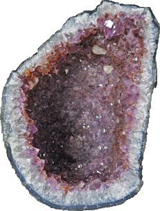

# Amethyst: Characteristics and Effects

## Overview

Amethyst is the purple variety of [[Quartz]], closely related to [[Rock Crystal]]. It is often encountered as crystal-lined [[Geode]] material, with the deeper violet color concentrated toward the crystal tips. Its color zoning, geode growth, and range from transparent purple crystals to opaque chevron material make it both visually recognizable and mineralogically interesting.

The stone has many named forms and trade names. Chevron amethyst is intergrown with white quartz in V-shaped bands; cactus quartz or spirit quartz is covered with smaller crystals; scepter quartz has one crystal grown over another; and names such as Super Seven, Red Cap Amethyst, Auralite, Sacred Seven, Agape crystal, Synergite, Melody Stone, aurora quartz, anandalite, and rainbow quartz appear in trade or esoteric contexts. Some purple stones sold with amethyst-like names are not amethyst at all, so identity matters.

In traditional gemstone therapy, amethyst is treated as a stone of detachment, spirituality, harmony, mental clarity, restful sleep, and relief from headaches. Historically, it has been connected with anti-drunkenness beliefs, religious jewelry, royal regalia, mourning colors, and carved devotional or ornamental objects.

For scientific readers, the [[#Composition|composition]] is simple at the species level: amethyst is [[Quartz]] with formula SiO2, while trace elements and irradiation explain the purple color.

Visually, the [[#Appearance|appearance]] is easiest to recognize through purple zoning, darker tips, geode fragments, and chevron banding.

The wider graph connects amethyst to [[Quartz]], [[Rock Crystal]], [[Citrine]], [[Ametrine]], [[Iron]], [[Titanium]], and [[Geode]].

## Table Of Contents

- [[#Overview]]
- [[#Lead Image]]
- [[#Key Identity]]
- [[#Composition]]
- [[#Appearance]]
- [[#Geology And Occurrence]]
- [[#Varieties Trade Names And Lookalikes]]
- [[#Name Origin]]
- [[#History And Cultural Use]]
- [[#Energetic And Therapeutic Traditions]]
- [[#Runes And Symbolic Associations]]
- [[#Zodiac Signs]]
- [[#Did You Know]]
- [[#Images]]
- [[#Sources]]
- [[#Validation Notes]]
- [[#Source Notes]]

## Lead Image

| [[gemstone-dictionary#Field\|Field]] | [[gemstone-dictionary#Value\|Value]] |
|---|---|
| [[gemstone-dictionary#Image URL\|Image URL]] | https://www.semoea.nl/images/stories/amethist-geode1.gif |
| [[gemstone-dictionary#Alt Text\|Alt text]] | amethist geode |
| [[gemstone-dictionary#Caption\|Caption]] | Amethist geode |

## Key Identity

| [[gemstone-dictionary#Field\|Field]] | [[gemstone-dictionary#Value\|Value]] |
|---|---|
| [[gemstone-dictionary#Dutch Name\|Dutch name]] | Amethist |
| [[gemstone-dictionary#English Name\|English name]] | Amethyst |
| [[gemstone-dictionary#Scientific Name / Mineral Species\|Scientific name / mineral species]] | [[Quartz]] |
| [[gemstone-dictionary#Gemstone Variety Of\|Gemstone variety of]] | [[Quartz]] |
| [[gemstone-dictionary#Mineral Group / Family\|Mineral group / family]] | [[Silica]]; [[Quartz]] family |
| [[gemstone-dictionary#Chemical Class\|Chemical class]] | [[Oxide]] / silicate framework |
| [[gemstone-dictionary#Related Stones\|Related stones]] | [[Rock Crystal]], [[Citrine]], [[Ametrine]], [[Smoky Quartz]], [[Rose Quartz]] |
| [[gemstone-dictionary#Primary Source\|Primary source]] | [Semoea page](https://www.semoea.nl/edelstenen/amethist.html) |

## Composition

| [[gemstone-dictionary#Field\|Field]] | [[gemstone-dictionary#Value\|Value]] |
|---|---|
| [[gemstone-dictionary#Source Notation\|Source notation]] | SiO2 + (Fe, Al, Ti, Na, Li). |
| [[gemstone-dictionary#Normalized Markdown Notation\|Normalized Markdown notation]] | SiO2 + ([[Iron\|Fe]], [[Aluminium\|Al]], [[Titanium\|Ti]], [[Sodium\|Na]], [[Lithium\|Li]]) |
| [[gemstone-dictionary#Ideal Mineral Formula\|Ideal mineral formula]] | SiO2 |
| [[gemstone-dictionary#Scientific Name / Mineral Species\|Scientific name / mineral species]] | [[Quartz]] |
| [[gemstone-dictionary#Mineral Group / Family\|Mineral group / family]] | [[Silica]]; [[Quartz]] |
| [[gemstone-dictionary#Chemical Class\|Chemical class]] | [[Oxide]] / tectosilicate-style silica framework |
| [[gemstone-dictionary#Formula Notes\|Formula notes]] | The source notation preserves Semoea's trace-element additions. Mindat and GIA validate amethyst as quartz with ideal formula SiO2; purple color is associated with iron-related color centers and irradiation. |
| [[gemstone-dictionary#Trace Elements / Substitutions\|Trace elements / substitutions]] | [[Iron]], [[Aluminium]], [[Titanium]], [[Sodium]], [[Lithium]] |
| [[gemstone-dictionary#Inclusions\|Inclusions]] | Goethite, lepidocrocite, hematite, titanium dioxide needles, gas bubbles, and fluid inclusions are mentioned. |
| [[gemstone-dictionary#Color-Causing Elements\|Color-causing elements]] | Mainly [[Iron]], with irradiation and color-center behavior; [[Titanium]] is also highlighted in the primary source. |
| [[gemstone-dictionary#External Validation\|External validation]] | Mindat, GIA, and Webmineral agree on quartz identity and SiO2 formula. |

## Appearance

| [[gemstone-dictionary#Property\|Property]] | [[gemstone-dictionary#Value\|Value]] |
|---|---|
| [[gemstone-dictionary#Color\|Color]] | Purple to violet; often zoned, with darker crystal tips. |
| [[gemstone-dictionary#Luster\|Luster]] | Not listed on source page. |
| [[gemstone-dictionary#Transparency\|Transparency]] | Transparent, translucent, or opaque in chevron amethyst. |
| [[gemstone-dictionary#Hardness\|Hardness]] | 7, brittle. |
| [[gemstone-dictionary#Density\|Density]] | 2.63 - 2.65. |
| [[gemstone-dictionary#Crystal System\|Crystal system]] | Trigonal, macrocrystalline. |
| [[gemstone-dictionary#Cleavage\|Cleavage]] | Indistinct. |
| [[gemstone-dictionary#Fracture\|Fracture]] | Conchoidal, splintery. |
| [[gemstone-dictionary#Habit / Growth Form\|Habit / growth form]] | Geode crystals, amethyst roses, scepter quartz, cactus/spirit quartz. |
| [[gemstone-dictionary#Distinctive Visual Markers\|Distinctive visual markers]] | Purple zoning, darker tips, dichroism, geode fragments, white chevron bands. |

## Geology And Occurrence

Amethyst commonly grows as quartz crystals in cavities and geodes. The best-known historical mine mentioned by the primary source is [[Idar-Oberstein]] in [[Germany]], now exhausted. Major modern sources include southern [[Brazil]] and [[Uruguay]], with Brazilian material described as having relatively large crystals and Uruguayan material often being very dark.

| [[gemstone-dictionary#Topic\|Topic]] | [[gemstone-dictionary#Details\|Details]] |
|---|---|
| [[gemstone-dictionary#Formation Environment\|Formation environment]] | Quartz growth in cavities and geodes. |
| [[gemstone-dictionary#Common Host Rocks\|Common host rocks]] | Cavity-bearing rock; specific host rocks not listed on source page. |
| [[gemstone-dictionary#Notable Locations\|Notable locations]] | [[Idar-Oberstein]], southern [[Brazil]], [[Uruguay]], [[South Africa]] for lavender cactus quartz. |
| [[gemstone-dictionary#Mining / Source Notes\|Mining / source notes]] | [[Idar-Oberstein]] is historically important but exhausted; [[Brazil]] and [[Uruguay]] are major modern sources. |

## Varieties Trade Names And Lookalikes

Amethyst names can describe growth form, inclusions, color pattern, or trade storytelling. The useful distinction is whether the name still describes quartz or whether it is being used for a different purple mineral.

| [[gemstone-dictionary#Name\|Name]] | [[gemstone-dictionary#Relationship\|Relationship]] | [[gemstone-dictionary#Notes\|Notes]] |
|---|---|---|
| [[Chevron Amethyst]] | Variety / intergrowth | Opaque amethyst with V-shaped white quartz bands. |
| [[Cactus Quartz]] / [[Spirit Quartz]] | Growth form / trade name | Main crystal overgrown with smaller crystals. |
| [[Scepter Quartz]] | Growth form | One quartz crystal grown over another. |
| [[Super Seven]] | Trade name | Presented as amethyst with other minerals; source cautions that goethite inclusions may be the more realistic explanation. |
| [[Red Cap Amethyst]] | Trade name | Purple quartz with rust-colored cap or surface layer. |
| [[Auralite]], [[Sacred Seven]], [[Agape Crystal]], [[Synergite]], [[Melody Stone]] | Trade names | Esoteric or commercial naming layer. |
| Lithium amethyst | Lookalike / misleading trade name | Can refer to [[Kunzite]], not amethyst. |
| Oriental amethyst | Lookalike / misleading trade name | Can refer to purple [[Spinel]], [[Corundum]], or [[Sapphire]]. |

## Name Origin

The name amethyst comes from Greek roots meaning "not drunk", connected with ancient ideas that the stone could prevent intoxication. Several variety and trade names arise from shape, markings, color, or esoteric tradition.

| [[gemstone-dictionary#Name Or Term\|Name or term]] | [[gemstone-dictionary#Origin / Meaning\|Origin / meaning]] |
|---|---|
| Amethyst | From Greek roots meaning "not drunk". |
| Cactus quartz | Named for a spiky appearance. |
| Spirit quartz | Connected with the English word "spirit". |
| Scepter quartz | Named for resemblance to a royal scepter. |
| Chevron amethyst | Named after V-shaped white markings. |
| Red Cap Amethyst | Named for a rust-red cap or top layer. |
| Auralite | Connected with `aura` meanings in trade/esoteric language. |
| Melody Stone | Connected with author Melody and the `Love is in the Earth` stone books. |

## History And Cultural Use

Amethyst has a long cultural record as an ornamental, symbolic, and healing stone. It appears in [[Ancient Egypt|ancient Egyptian]] contexts, [[Mycenae|Mycenaean]] grave finds, [[Etruscans|Etruscan]] and [[Ancient Rome|Roman]] intaglios, and [[Ancient Greece|Greek]] and [[Ancient Rome|Roman]] anti-drunkenness traditions. [[Pliny the Elder]] wrote about stone lore and warned against exaggerated claims.

The stone is also tied to [[Finland|Finnish]] shaman stones, [[China|Chinese]] legal-luck beliefs, [[Middle Ages|medieval]] anti-poison associations, [[England|English]] regalia, royal jewelry, [[Leonardo da Vinci]] lore, mourning and penitence colors in the 18th and 19th centuries, [[Jugendstil]] and [[Art Nouveau]] jewelry, [[Faberge]] work, and [[India|Indian]] [[Ganesha]] carvings.

## Energetic And Therapeutic Traditions

Therapeutic claims are source-attributed and not medical advice.

### Overview

In gemstone therapy, amethyst is mainly treated as a clarifying, calming, spiritual, and sleep-supporting quartz.

### Spiritual

- Associated with the forehead and crown chakras.
- Placed above the crown to open it, on the heart to open the heart chakra, and below the base chakra to support grounding and connection with the earth.
- Linked with spiritual growth, [[concepts/mental/intuition|intuition]], detachment, and wisdom.
- Helps frame the relativity of things and accept loss as part of life, leaving room for new developments.
- Associated with searching for the meaning of life.
- Used during meditation to find inner silence.

### Mental

- Makes the wearer strong-willed without necessarily making them highly active.
- Encourages looking without judgment and with compassion at oneself, others, and the surroundings.
- Associated with honesty and justice, including a traditional connection with judges and lawyers.
- Used for inner division, doubt, and [[concepts/mental/decision-making|decision stress]] by calmly examining the available options.
- Helps distinguish what is genuinely important from what is not.

### Emotional

- Used in the source tradition for [[concepts/emotional/grief|grief]] and accepting loss.
- Described as a stone of letting go and breaking negative behavior patterns and habits through meditation.
- Associated with reducing disappointment, despair, and gloom.
- Encourages responding, speaking, and working from the heart.
- Associated with comfort, [[concepts/emotional/calm|calm]], and protection during [[concepts/emotional/fear|fear and phobias]].

### Physical

- Associated with [[concepts/physical/headache|headaches]], especially claims involving the hypothalamus, and the source gives forehead or short-necklace placement instructions.
- Linked with the pineal gland, [[concepts/physical/sleep|falling asleep]], staying asleep, and nightmares; the source describes a piece on the nightstand or under the pillow.
- Associated with hormonal glands, especially the pancreas and diabetes-related claims.
- Linked with nervousness, stress, [[concepts/mental/concentration|concentration]], blood, blood composition, circulation, heart, and blood vessels.
- Associated with skin complaints, hair, nails, bones, calmer behavior, hyperactivity, and reducing the perceived effects of too much coffee.
- The source also mentions amethyst water for cleaner skin and shinier hair.

## Runes And Symbolic Associations

| [[gemstone-dictionary#Field\|Field]] | [[gemstone-dictionary#Value\|Value]] |
|---|---|
| [[gemstone-dictionary#Rune Name\|Rune name]] | Thurs |
| [[gemstone-dictionary#Rune Symbol / Image\|Rune symbol/image]] | https://www.semoea.nl/images/stories/figuur/runeTh.jpg |
| [[gemstone-dictionary#Meaning\|Meaning]] | Thorn, giant, protection. |
| [[gemstone-dictionary#Relation To Gemstone\|Relation to gemstone]] | Protective, cleansing, and active against negative influences. |

## Zodiac Signs

| [[gemstone-dictionary#Zodiac Sign\|Zodiac sign]] | [[gemstone-dictionary#Notes\|Notes]] |
|---|---|
| [[Aquarius]] | Listed by the primary source. |
| [[Pisces]] | Listed by the primary source. |
| [[Aries]] | Listed by the primary source. |
| [[Sagittarius]] | Listed by the primary source. |

## Did You Know

- Amethyst can grow together with other quartz varieties, including ametrine and citrine in geodes.
- Geodes can contain differently colored quartz layers such as white quartz, blue chalcedony, amethyst, and smoky quartz.
- Amethyst can contain many inclusions, including gases, fluids, goethite, lepidocrocite, hematite, and titanium dioxide.
- Amethyst geodes are used in gemstone therapy to cleanse other stones energetically.
- The primary source includes an immune-system gemstone-therapy claim.

## Images

| [[gemstone-dictionary#Image URL\|Image URL]] | [[gemstone-dictionary#Alt Text\|Alt text]] | [[gemstone-dictionary#Title\|Title]] | [[gemstone-dictionary#Caption\|Caption]] | [[gemstone-dictionary#Section\|Section]] |
|---|---|---|---|---|
| https://www.semoea.nl/images/stories/amethist-geode1.gif | amethist geode | Amethist geode | Amethist geode | Lead Image |
| https://www.semoea.nl/images/stories/amethist.jpg | Amethist kristallen | Amethist kristallen, stukje van een geode | Amethist kristallen, stukje van een geode | Overview |
| https://www.semoea.nl/images/stories/chevronamethist.jpg | chevron-amethist | Chevron-amethist | Chevron-amethist | Varieties Trade Names And Lookalikes |
| https://www.semoea.nl/images/stories/amethist-hartje.jpg | amethist hartje | Amethist hartje | Amethist hartje | Name Origin |
| https://www.semoea.nl/images/stories/amethist-cactuskwarts.jpg | amethist cactuskwarts | Amethist cactuskwarts | Amethist cactuskwarts | Name Origin |
| https://www.semoea.nl/images/stories/fotoshow/amethist.jpg | amethist | Micro-opname amethist | Micro-opname amethist | Sources |

## Sources

| [[gemstone-dictionary#Source\|Source]] | [[gemstone-dictionary#URL\|URL]] | [[gemstone-dictionary#Role\|Role]] |
|---|---|---|
| Semoea | https://www.semoea.nl/edelstenen/amethist.html | Primary source |
| Mindat - Amethyst | https://www.mindat.org/min-198.html | Scientific validation |
| GIA - Amethyst | https://www.gia.edu/amethyst | Gemological validation |
| Webmineral - Quartz | https://webmineral.com/data/Quartz.shtml | Mineral formula and physical-property validation |
| Wikipedia NL - Amethist | http://nl.wikipedia.org/wiki/Amethist | Source-page listed reference |

## Validation Notes

| [[gemstone-dictionary#Check\|Check]] | [[gemstone-dictionary#Result\|Result]] |
|---|---|
| Semoea structure preserved | Yes; source sections are represented in the reorganized template. |
| Empty fields preserved | Yes; missing luster is marked explicitly. |
| Composition source notation preserved exactly | Yes: SiO2 + (Fe, Al, Ti, Na, Li). |
| Composition externally validated | Yes; quartz identity and SiO2 formula checked against Mindat, GIA, and Webmineral. |
| At least two external sources added | Yes. |
| Therapeutic claims attributed | Yes; framed as gemstone-therapy tradition, not medical advice. |
| Therapeutic coverage complete against source | Yes; the detailed indexed therapeutic lists are represented claim by claim. |
| Therapeutic instructions and warnings preserved | Yes; placements, water use, and source qualifiers are retained. |
| Source-specific context coverage complete | Yes; historical, naming, symbolic, trade, and `Did You Know` details are represented. |
| Source disclaimers and responsibility statements preserved | Yes; source responsibility and medical-care boundaries are represented in the page and notes. |
| Therapeutic concepts source-mapped | Initial controlled vocabulary mapped from explicit source themes; prose remains canonical. |
| Therapeutic concept candidates reconciled | Not yet; see the therapeutic concept coverage audit. |
| Body uses observational voice | Yes. |
| Content not compressed into high-level summary | Yes for proof-run coverage; long prose is paraphrased rather than copied. |

## Source Notes

- Content is based primarily on Semoea, with scientific validation from Mindat, GIA, and Webmineral.
- Long source prose has been rewritten into original wording while preserving factual coverage.
- Therapeutic content remains attributed to tradition/source context and is not medical advice.
