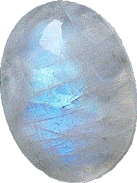

# Moonstone: Characteristics and Effects

## Overview

Moonstone is a [[Feldspar]] gemstone known for soft body colors and a floating, moonlike sheen. Grey material is common, but white, yellow, pink, cream, brown, black, and blue-sheened stones also occur. The moving glow, especially in [[Blue Moonstone]], is the visual feature that makes the stone attractive in jewelry.

Scientifically, moonstone is best understood as a feldspar variety rather than a single simple species name. Traditional moonstone is often described as [[Orthoclase]] or adularia with [[Albite]] lamellae; the primary source describes layered potassium feldspar and sodium feldspar. That layered structure is also the key to its adularescence.

In gemstone therapy, moonstone is treated as a stone of hope, intuition, feeling, love, fertility, feminine qualities, and moon-related cleansing. The cultural story is equally lunar: moon-goddess traditions, [[India|ancient Indian]] ideas of solidified moonlight, wedding associations, women's jewelry, and [[Yin and Yang|yin-yang]] balancing all belong to its symbolic field.

The [[#Composition|composition]] is the expert hinge: (Na,K)AlSi3O8 plus trace Ca, Fe, Ba, Rb, and Sr, with a feldspar-variety caveat.

The [[#Appearance|appearance]] depends less on strong color than on sheen, layering, and the direction-sensitive glow called adularescence.

Graph links worth following: [[Feldspar]], [[Orthoclase]], [[Albite]], [[Adularescence]], [[Amazonite]], and [[Labradorite]].

## Table Of Contents

- [[#Overview]]
- [[#Lead Image]]
- [[#Key Identity]]
- [[#Composition]]
- [[#Appearance]]
- [[#Geology And Occurrence]]
- [[#Varieties Trade Names And Lookalikes]]
- [[#Name Origin]]
- [[#History And Cultural Use]]
- [[#Energetic And Therapeutic Traditions]]
- [[#Runes And Symbolic Associations]]
- [[#Zodiac Signs]]
- [[#Did You Know]]
- [[#Images]]
- [[#Sources]]
- [[#Validation Notes]]
- [[#Source Notes]]

## Lead Image

| [[gemstone-dictionary#Field\|Field]] | [[gemstone-dictionary#Value\|Value]] |
|---|---|
| [[gemstone-dictionary#Image URL\|Image URL]] | https://www.semoea.nl/images/stories/blauwe-maansteen.gif |
| [[gemstone-dictionary#Alt Text\|Alt text]] | blauwe maansteen |
| [[gemstone-dictionary#Caption\|Caption]] | Not listed on source page. |

## Key Identity

| [[gemstone-dictionary#Field\|Field]] | [[gemstone-dictionary#Value\|Value]] |
|---|---|
| [[gemstone-dictionary#Dutch Name\|Dutch name]] | Maansteen |
| [[gemstone-dictionary#English Name\|English name]] | Moonstone |
| [[gemstone-dictionary#Scientific Name / Mineral Species\|Scientific name / mineral species]] | Feldspar-group gemstone variety; commonly [[Orthoclase]] / adularia with [[Albite]] lamellae |
| [[gemstone-dictionary#Gemstone Variety Of\|Gemstone variety of]] | [[Feldspar]] |
| [[gemstone-dictionary#Mineral Group / Family\|Mineral group / family]] | [[Feldspar]]; [[Alkali Feldspar]] |
| [[gemstone-dictionary#Chemical Class\|Chemical class]] | [[Tectosilicate]] |
| [[gemstone-dictionary#Related Stones\|Related stones]] | [[Amazonite]], [[Labradorite]], [[Orthoclase]], [[Albite]] |
| [[gemstone-dictionary#Primary Source\|Primary source]] | [Semoea page](https://www.semoea.nl/edelstenen/maansteen.html) |

## Composition

| [[gemstone-dictionary#Field\|Field]] | [[gemstone-dictionary#Value\|Value]] |
|---|---|
| [[gemstone-dictionary#Source Notation\|Source notation]] | (Na,K)AlSi3O8 + Ca, Fe, Ba, Rb, Sr |
| [[gemstone-dictionary#Normalized Markdown Notation\|Normalized Markdown notation]] | ([[Sodium\|Na]],[[Potassium\|K]])AlSi3O8 + [[Calcium\|Ca]], [[Iron\|Fe]], [[Barium\|Ba]], [[Rubidium\|Rb]], [[Strontium\|Sr]] |
| [[gemstone-dictionary#Ideal Mineral Formula\|Ideal mineral formula]] | Feldspar-series notation varies; traditional orthoclase is KAlSi3O8, while albite is NaAlSi3O8. |
| [[gemstone-dictionary#Scientific Name / Mineral Species\|Scientific name / mineral species]] | Feldspar variety, commonly orthoclase/adularia with albite lamellae |
| [[gemstone-dictionary#Mineral Group / Family\|Mineral group / family]] | [[Feldspar]] |
| [[gemstone-dictionary#Chemical Class\|Chemical class]] | [[Tectosilicate]] |
| [[gemstone-dictionary#Formula Notes\|Formula notes]] | The source notation expresses a sodium-potassium feldspar with additional elements. GIA validates moonstone as orthoclase with albite layers; Mindat material supports the caveat that moonstone is a variety/trade term applied to feldspars showing adularescence. |
| [[gemstone-dictionary#Trace Elements / Substitutions\|Trace elements / substitutions]] | Ca, Fe, Ba, Rb, Sr in the primary-source notation. |
| [[gemstone-dictionary#Inclusions\|Inclusions]] | Iron is specifically connected with red to dark colors, especially smoky moonstone. |
| [[gemstone-dictionary#Color-Causing Elements\|Color-causing elements]] | [[Iron]] for red to dark colors; sodium-rich layering is associated with bluer sheen. |
| [[gemstone-dictionary#External Validation\|External validation]] | GIA and Mindat validate feldspar identity, adularescence, and variety/trade-name caveats. |

## Appearance

| [[gemstone-dictionary#Property\|Property]] | [[gemstone-dictionary#Value\|Value]] |
|---|---|
| [[gemstone-dictionary#Color\|Color]] | Grey, white, yellow, pink, cream, brown, black; blue sheen in [[Blue Moonstone]]. |
| [[gemstone-dictionary#Luster\|Luster]] | Vitreous, pearly. |
| [[gemstone-dictionary#Transparency\|Transparency]] | Transparent to translucent with moonlike sheen. |
| [[gemstone-dictionary#Hardness\|Hardness]] | 6.0 - 6.5. |
| [[gemstone-dictionary#Density\|Density]] | 2.53 - 2.63. |
| [[gemstone-dictionary#Crystal System\|Crystal system]] | Monoclinic in the primary-source property block. |
| [[gemstone-dictionary#Cleavage\|Cleavage]] | Excellent. |
| [[gemstone-dictionary#Fracture\|Fracture]] | Conchoidal, rough, splintery. |
| [[gemstone-dictionary#Habit / Growth Form\|Habit / growth form]] | Layered feldspar structure. |
| [[gemstone-dictionary#Distinctive Visual Markers\|Distinctive visual markers]] | Satin-like adularescence; moving blue or white glow. |

## Geology And Occurrence

Moonstone's visible glow comes from layered feldspar structure. Light is scattered between layers of potassium feldspar and sodium feldspar; thinner layers intensify the effect, and a higher sodium component is linked with a bluer sheen.

| [[gemstone-dictionary#Topic\|Topic]] | [[gemstone-dictionary#Details\|Details]] |
|---|---|
| [[gemstone-dictionary#Formation Environment\|Formation environment]] | Intergrown feldspar layers. |
| [[gemstone-dictionary#Common Host Rocks\|Common host rocks]] | Not listed on source page. |
| [[gemstone-dictionary#Notable Locations\|Notable locations]] | [[Adula Alps]] are named in relation to [[Adularia]]; [[India]] and [[Sri Lanka]] appear in the cultural section. |
| [[gemstone-dictionary#Mining / Source Notes\|Mining / source notes]] | Not listed on source page. |

## Varieties Trade Names And Lookalikes

Moonstone naming is partly mineralogical and partly gem-trade language. The most important scientific caution is that moonstone may refer to feldspar material showing adularescence rather than one single mineral species in all contexts.

| [[gemstone-dictionary#Name\|Name]] | [[gemstone-dictionary#Relationship\|Relationship]] | [[gemstone-dictionary#Notes\|Notes]] |
|---|---|---|
| [[Blue Moonstone]] | Variety / visual type | Moonstone with clear blue sheen; the most valued type in the primary source. |
| [[Adularia]] | Related name | Named after the [[Adula Alps]] in [[Switzerland]]. |
| Brown moonstone | Color variety | Illustrated and discussed in the article. |
| Smoky moonstone | Color variety | Red to dark color connected with iron impurities. |
| Rainbow moonstone | Trade caveat | Often used in gem trade for feldspar material; external sources should validate species. |

## Name Origin

| [[gemstone-dictionary#Name Or Term\|Name or term]] | [[gemstone-dictionary#Origin / Meaning\|Origin / meaning]] |
|---|---|
| Moonstone | Named after the moon because of the soft sheen and appearance. |
| Adularia | Named after the [[Adula Alps]] in [[Switzerland]]. |

## History And Cultural Use

Moonstone is connected with lunar symbolism across several traditions. It was associated with the moon goddess, [[Ancient Greece|ancient Greek]] and [[Ancient Rome|Roman]] protection and fertility lore, [[India|ancient Indian]] ideas of solidified moonlight and [[Lakshmi]]'s blessing, fertility and prosperity talismans, [[Wilkie Collins]]'s 1868 novel, [[Middle East|Middle Eastern]] women's jewelry, third-eye associations in [[India]] and [[Sri Lanka]], wedding gifts, and [[China|Chinese]] [[Yin and Yang|yin-yang]] balancing beliefs.

## Energetic And Therapeutic Traditions

Therapeutic claims are source-attributed and not medical advice.

### Overview

Moonstone is mainly treated as a lunar, feminine, hopeful, emotionally balancing, fertility-oriented stone.

### Spiritual

- Associated especially with the sacral chakra and also with the heart, forehead, and crown chakras.
- Enlarges the heart chakra in the source tradition, supporting [[concepts/emotional/empathy|empathy]] and spiritual growth through compassion.
- Enlarges the forehead chakra, associated with [[concepts/mental/intuition|intuition]] and people knowledge.
- Enlarges the crown chakra, associated with spiritual growth through connectedness.
- Strengthens the feminine side, including in men.
- Linked with the moon, moon cycles, the sea, tides, and mediumistic sensitivity.
- Meditation during the full moon is associated with increased [[concepts/mental/intuition|intuition]] and clairvoyance.

### Mental

- Makes the wearer more empathic and receptive to other people.
- Gives spontaneous ideas and [[concepts/mental/creativity|creative insights]] more room and energy to become real.
- Deepens and nuances the inner or spiritual life; the source describes wearing a white moonstone pendant on the heart.

### Emotional

- Associated with cleansing the emotional layer of the aura and reducing emotional outbursts.
- Helps bring emotions into balance and changes listlessness, [[concepts/emotional/loneliness|loneliness]], and abandonment toward active engagement.
- Softens hardened or embittered feelings.
- Associated with balance during stress and overload.
- Represents [[concepts/emotional/hope|hope]].

### Physical

- Linked with organs associated with the sacral chakra, including bladder complaints, the lymphatic system, and edema.
- Associated with blood, lymph, kidney, and bladder [[concepts/physical/circulation|circulation]].
- Linked with short-term memory and study support for children preparing for tests or examinations.
- Associated with the pineal gland, day-night rhythm, and seasonal rhythm.
- Linked with growth in children, pituitary and [[concepts/physical/reproductive-health|reproductive organs]], menstruation, fertility, pregnancy, menopause, asthma complaints, [[concepts/physical/digestion|digestion]], and insect-bite reactions.
- The source describes placing the stone under the navel for menstruation-related use and on the heart for emotional effects.

## Runes And Symbolic Associations

| [[gemstone-dictionary#Field\|Field]] | [[gemstone-dictionary#Value\|Value]] |
|---|---|
| [[gemstone-dictionary#Rune Name\|Rune name]] | Reid |
| [[gemstone-dictionary#Rune Symbol / Image\|Rune symbol/image]] | https://www.semoea.nl/images/stories/figuur/runeR.jpg |
| [[gemstone-dictionary#Meaning\|Meaning]] | Wheel, wagon, travel, learning. |
| [[gemstone-dictionary#Relation To Gemstone\|Relation to gemstone]] | Connected with creatively solving problems on life's journey. |

## Zodiac Signs

| [[gemstone-dictionary#Zodiac Sign\|Zodiac sign]] | [[gemstone-dictionary#Notes\|Notes]] |
|---|---|
| [[Cancer]] | Listed by the primary source. |
| [[Capricorn]] | Listed by the primary source. |
| [[Pisces]] | Listed by the primary source. |

## Did You Know

- Ayurveda connects moonstone with the heart chakra.
- Moonstone is described as helping someone open to love.
- Moonstone is described as removing stress and tension, especially health-related worry.
- Moonstone is said to affect women more strongly than men because of moon-point lore.

## Images

| [[gemstone-dictionary#Image URL\|Image URL]] | [[gemstone-dictionary#Alt Text\|Alt text]] | [[gemstone-dictionary#Title\|Title]] | [[gemstone-dictionary#Caption\|Caption]] | [[gemstone-dictionary#Section\|Section]] |
|---|---|---|---|---|
| https://www.semoea.nl/images/stories/blauwe-maansteen.gif | blauwe maansteen | Not listed on source page. | Not listed on source page. | Lead Image |
| https://www.semoea.nl/images/stories/maansteen-oorbellen.jpg | maansteen oorbellen | Maansteen oorbellen | Maansteen oorbellen | History And Cultural Use |
| https://www.semoea.nl/images/stories/maansteen-ring.jpg | maansteen ring | Ring met maansteen | Ring met maansteen | History And Cultural Use |
| https://www.semoea.nl/images/stories/maanstenen.jpg | maansteen trommelstenen | Trommelstenen van maansteen | Trommelstenen van maansteen | Energetic And Therapeutic Traditions |
| https://www.semoea.nl/images/stories/maansteen-bruin.jpg | maansteen-bruin | Bruine maansteen | Bruine maansteen | Energetic And Therapeutic Traditions |
| https://www.semoea.nl/images/stories/maansteen-hanger.jpg | maansteen hanger | Hanger met maansteen | Hanger met maansteen | Geology And Occurrence |
| https://www.semoea.nl/images/stories/maansteen-staaf.jpg | maansteen staaf | Massagestaaf van maansteen | Massagestaaf van maansteen | Sources |

## Sources

| [[gemstone-dictionary#Source\|Source]] | [[gemstone-dictionary#URL\|URL]] | [[gemstone-dictionary#Role\|Role]] |
|---|---|---|
| Semoea | https://www.semoea.nl/edelstenen/maansteen.html | Primary source |
| GIA - Moonstone | https://www.gia.edu/moonstone?hl=en-US | Gemological validation |
| Mindat - Moonstone | https://www.mindat.org/min-2774.html | Locality and mineralogical validation |
| Mindat discussion - Moonstone classification | https://www.mindat.org/mesg-91292.html | Classification caveat |
| Wikipedia EN - Moonstone | http://en.wikipedia.org/wiki/Moonstone_(gemstone) | Source-page listed reference |

## Validation Notes

| [[gemstone-dictionary#Check\|Check]] | [[gemstone-dictionary#Result\|Result]] |
|---|---|
| Semoea structure preserved | Yes; source sections are represented in the reorganized template. |
| Empty fields preserved | Yes; missing lead caption is marked explicitly. |
| Composition source notation preserved exactly | Yes: (Na,K)AlSi3O8 + Ca, Fe, Ba, Rb, Sr |
| Composition externally validated | Yes, with feldspar-variety caveat. |
| At least two external sources added | Yes. |
| Therapeutic claims attributed | Yes; framed as gemstone-therapy tradition, not medical advice. |
| Therapeutic coverage complete against source | Yes; the detailed indexed therapeutic lists are represented claim by claim. |
| Therapeutic instructions and warnings preserved | Yes; placements, timing, and source qualifiers are retained. |
| Source-specific context coverage complete | Yes; historical, naming, symbolic, trade, and `Did You Know` details are represented. |
| Source disclaimers and responsibility statements preserved | Yes; source responsibility and medical-care boundaries are represented in the page and notes. |
| Therapeutic concepts source-mapped | Initial controlled vocabulary mapped from explicit source themes; prose remains canonical. |
| Therapeutic concept candidates reconciled | Not yet; see the therapeutic concept coverage audit. |
| Body uses observational voice | Yes. |
| Content not compressed into high-level summary | Yes for proof-run coverage; long prose is paraphrased rather than copied. |

## Source Notes

- Content is based primarily on Semoea, with scientific validation from GIA and Mindat.
- Moonstone identity is intentionally cautious because the name is used across feldspar materials.
- Therapeutic content remains attributed to tradition/source context and is not medical advice.
