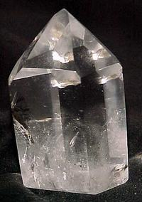

# Rock Crystal: Characteristics and Effects

## Overview

Rock crystal is the clear, water-transparent variety of [[Quartz]]. It can also appear milky white when tiny air or water bubbles are included, shifting the look toward [[White Quartz]], [[Milky Quartz]], or [[Snow Quartz]]. Its six-sided points, visible crystal faces, and glassy transparency make it the clearest member of the quartz family in both a literal and structural sense.

The stone is central in many gemstone-therapy traditions because it is treated as cleansing, amplifying, balancing, and broadly supportive. It is also a useful anchor stone for the wider quartz graph: amethyst, citrine, smoky quartz, rose quartz, rutile quartz, and many named point forms all connect back to quartz.

Historically, rock crystal moves through [[Mesolithic]] ornaments, [[Mesopotamia|Mesopotamian]] seals, [[Ancient Rome|Roman]] drinking vessels, [[Tibet|Tibetan]] dorjes, reliquaries, [[House of Stuart|Stuart]] crystals, [[Victorian era|Victorian]] carved jewelry, [[Faberge]] objects, crystal balls, [[Art Deco]] jewelry, and modern aura-coated quartz. This is one of those stones where mineral simplicity and cultural abundance sit side by side.

The [[#Composition|composition]] is beautifully direct: SiO2, validated across Semoea, Mindat, and Webmineral.

The [[#Appearance|appearance]] depends on clarity, six-sided quartz habit, transverse growth lines, inclusions, and whether the material is water-clear or milky.

Graph links worth following: [[Quartz]], [[Silica]], [[Amethyst]], [[Citrine]], [[Smoky Quartz]], [[Rutile]], [[Chlorite]], and [[Goethite]].

## Table Of Contents

- [[#Overview]]
- [[#Lead Image]]
- [[#Key Identity]]
- [[#Composition]]
- [[#Appearance]]
- [[#Geology And Occurrence]]
- [[#Varieties Trade Names And Lookalikes]]
- [[#Name Origin]]
- [[#History And Cultural Use]]
- [[#Energetic And Therapeutic Traditions]]
- [[#Runes And Symbolic Associations]]
- [[#Zodiac Signs]]
- [[#Did You Know]]
- [[#Images]]
- [[#Sources]]
- [[#Validation Notes]]
- [[#Source Notes]]

## Lead Image

| [[gemstone-dictionary#Field\|Field]] | [[gemstone-dictionary#Value\|Value]] |
|---|---|
| [[gemstone-dictionary#Image URL\|Image URL]] | https://www.semoea.nl/images/stories/bergkristal.jpg |
| [[gemstone-dictionary#Alt Text\|Alt text]] | bergkristal |
| [[gemstone-dictionary#Caption\|Caption]] | Bergkristal met zeshoekige punt |

## Key Identity

| [[gemstone-dictionary#Field\|Field]] | [[gemstone-dictionary#Value\|Value]] |
|---|---|
| [[gemstone-dictionary#Dutch Name\|Dutch name]] | Bergkristal |
| [[gemstone-dictionary#English Name\|English name]] | Rock crystal |
| [[gemstone-dictionary#Scientific Name / Mineral Species\|Scientific name / mineral species]] | [[Quartz]] |
| [[gemstone-dictionary#Gemstone Variety Of\|Gemstone variety of]] | [[Quartz]] |
| [[gemstone-dictionary#Mineral Group / Family\|Mineral group / family]] | [[Silica]]; [[Quartz]] family |
| [[gemstone-dictionary#Chemical Class\|Chemical class]] | [[Oxide]] / silicate framework |
| [[gemstone-dictionary#Related Stones\|Related stones]] | [[Amethyst]], [[Citrine]], [[Smoky Quartz]], [[Rose Quartz]], [[Rutilated Quartz]] |
| [[gemstone-dictionary#Primary Source\|Primary source]] | [Semoea page](https://www.semoea.nl/edelstenen/bergkristal.html) |

## Composition

| [[gemstone-dictionary#Field\|Field]] | [[gemstone-dictionary#Value\|Value]] |
|---|---|
| [[gemstone-dictionary#Source Notation\|Source notation]] | SiO2 |
| [[gemstone-dictionary#Normalized Markdown Notation\|Normalized Markdown notation]] | SiO2 |
| [[gemstone-dictionary#Ideal Mineral Formula\|Ideal mineral formula]] | SiO2 |
| [[gemstone-dictionary#Scientific Name / Mineral Species\|Scientific name / mineral species]] | [[Quartz]] |
| [[gemstone-dictionary#Mineral Group / Family\|Mineral group / family]] | [[Silica]]; [[Quartz]] |
| [[gemstone-dictionary#Chemical Class\|Chemical class]] | [[Oxide]] / silicate framework |
| [[gemstone-dictionary#Formula Notes\|Formula notes]] | Rock crystal is a colorless transparent variety of quartz, not a separate mineral species. Semoea, Mindat, and Webmineral agree on SiO2. |
| [[gemstone-dictionary#Trace Elements / Substitutions\|Trace elements / substitutions]] | Not listed on source page. |
| [[gemstone-dictionary#Inclusions\|Inclusions]] | Microscopic air or water bubbles; chlorite, dumortierite, goethite, rutile, and actinolite are mentioned. |
| [[gemstone-dictionary#Color-Causing Elements\|Color-causing elements]] | Pure material is colorless; inclusions can tint the crystal. |
| [[gemstone-dictionary#External Validation\|External validation]] | Mindat and Webmineral validate quartz identity and formula. |

## Appearance

| [[gemstone-dictionary#Property\|Property]] | [[gemstone-dictionary#Value\|Value]] |
|---|---|
| [[gemstone-dictionary#Color\|Color]] | Water-clear to milky white. |
| [[gemstone-dictionary#Luster\|Luster]] | Vitreous. |
| [[gemstone-dictionary#Transparency\|Transparency]] | Transparent; can become translucent or opaque white from bubbles. |
| [[gemstone-dictionary#Hardness\|Hardness]] | 7. |
| [[gemstone-dictionary#Density\|Density]] | 2.65. |
| [[gemstone-dictionary#Crystal System\|Crystal system]] | Trigonal, hexagonal habit. |
| [[gemstone-dictionary#Cleavage\|Cleavage]] | Indistinct. |
| [[gemstone-dictionary#Fracture\|Fracture]] | Conchoidal, splintery. |
| [[gemstone-dictionary#Habit / Growth Form\|Habit / growth form]] | Macrocrystalline quartz points, six-sided crystals, double-terminated crystals, faden quartz, named point forms. |
| [[gemstone-dictionary#Distinctive Visual Markers\|Distinctive visual markers]] | Six-sided point, glassy clarity, transverse striations, inclusions, milky zones. |

## Geology And Occurrence

Rock crystal is macrocrystalline quartz. The source page emphasizes visible crystal points and many point forms rather than a single locality list. Inclusions can change the stone's appearance; once color becomes strong enough, the quartz may receive another variety name such as citrine, amethyst, or smoky quartz.

| [[gemstone-dictionary#Topic\|Topic]] | [[gemstone-dictionary#Details\|Details]] |
|---|---|
| [[gemstone-dictionary#Formation Environment\|Formation environment]] | Quartz crystal growth; specific geological setting not deeply specified on source page. |
| [[gemstone-dictionary#Common Host Rocks\|Common host rocks]] | Many rocks contain quartz; specific host rocks not listed on source page. |
| [[gemstone-dictionary#Notable Locations\|Notable locations]] | [[Mesopotamia]], [[Tibet]], [[Central America]], [[Middle East]], [[Europe]], [[South America]] appear in cultural/history contexts. |
| [[gemstone-dictionary#Mining / Source Notes\|Mining / source notes]] | Not listed on source page. |

## Varieties Trade Names And Lookalikes

Rock crystal has many named forms. Some describe clarity or inclusions; others describe point shape, surface markings, locality, or esoteric trade tradition.

| [[gemstone-dictionary#Name\|Name]] | [[gemstone-dictionary#Relationship\|Relationship]] | [[gemstone-dictionary#Notes\|Notes]] |
|---|---|---|
| [[White Quartz]] / [[Milky Quartz]] / [[Snow Quartz]] | Visual variety | White appearance caused by microscopic bubbles. |
| [[Azeztulite]] | Trade / esoteric name | White rock crystal trade name explained through spiritual tradition. |
| [[Herkimer Diamond]] | Quartz variety / trade name | Double-terminated rock crystal with high luster. |
| [[Cathedral Quartz]], [[Iris Quartz]], [[Satyaloka Quartz]] | Trade or growth-form names | Mentioned as names based on growth, locality, or inclusions. |
| [[Double-Terminated Quartz]], [[Faden Quartz]], [[Phantom Quartz]], [[Cactus Quartz]], [[Candle Quartz]], [[Artichoke Quartz]], [[Scepter Quartz]] | Growth forms | Different quartz point forms. |
| [[Lemurian Quartz]] | Surface-pattern trade name | Associated with transverse striations. |
| [[Friedlaender Quartz]] | Surface-pattern trade name | Associated with blocky growth-line forms. |

## Name Origin

| [[gemstone-dictionary#Name Or Term\|Name or term]] | [[gemstone-dictionary#Origin / Meaning\|Origin / meaning]] |
|---|---|
| Crystal | From Latin `crystallus` and Greek `krystallos`, crystal or ice. |
| Bergkristal / mountain crystal | `Berg` was added in the nineteenth century to distinguish the mineral from lead-glass crystal. |
| Quartz | `Kwarts` is connected with Slavic `kwady`, meaning hard. |
| Azeztulite | Trade name from crystal healer Naisha Ahsian, with `Azez` linked to a spiritual source of energy. |

## History And Cultural Use

Rock crystal appears in [[Mesolithic]] ornament and healing contexts in [[Europe]] and [[South America]], [[Mesopotamia|Mesopotamian]] cylinder seals, [[Ancient Rome|Roman]] traveler amulets and drinking vessels, [[Tibet|Tibetan]] healing implements, [[Central America]]n crystal-skull lore, [[Middle East|Middle Eastern]] carved bottles and weapon handles, [[Middle Ages|medieval]] reliquary jewelry, [[House of Stuart|Stuart]] crystals, [[Victorian era|Victorian]] medallions, signet rings, cameos and intaglios, [[Faberge]] objects, homeopathic [[Silicea]], crystal balls, [[Art Deco]] backing stones, and modern metal-vapor coatings such as [[Aqua Aura]] and [[Titanium Aura]].

## Energetic And Therapeutic Traditions

Therapeutic claims are source-attributed and not medical advice.

### Overview

Rock crystal is treated as the most neutral and versatile quartz in gemstone therapy, especially for cleansing, amplification, balance, and self-healing.

### Spiritual

- Used on all chakras, with special affinity for the base, heart, and crown chakras.
- Associated with connecting all chakras and filling the heart with light, especially through an octahedral crystal placed on the heart.
- Described as cleansing and strengthening subtle bodies and dissolving energetic blockages in chakras, ida and pingala, meridians, and nadis.
- The source instructs that released blockages should be naturally discharged and mentions drinking natural rock-crystal water as part of that tradition.
- Used to recognize and break old unwanted behavior patterns and support spiritual growth.
- Associated with clairvoyance, clairaudience, clairsentience, claircognizance, and clairgustance.
- Linked with meditation, [[concepts/mental/intuition|intuition]], the inner eye, aura cleansing, aura strengthening, and self-development in accordance with a divine plan.

### Mental

- Associated with energy, [[concepts/mental/willpower|willpower]], and goal-directedness.
- Looking at or meditating with rock crystal is linked with insight into personal motives and drives; phantom quartz receives an additional past-life association.
- Keeping rock crystal nearby while studying is associated with improved [[concepts/mental/concentration|concentration]].

### Emotional

- Associated with love, [[concepts/emotional/harmony|harmony]], and purity.
- Linked with opening the heart chakra, especially through rainbow crystals.
- Associated with an even mood and [[concepts/emotional/contentment|contentment]].

### Physical

- Treated in the source tradition as the most neutral and versatile crystal and as a general panacea supporting the body's self-healing capacity.
- Linked with [[concepts/physical/skin|skin]], hair, [[concepts/physical/bones|bones]], nails, teeth, small wounds, eczema, acne, brittle nails, brittle or dull hair, hair loss, excessive sweating, body odor, and sweaty feet.
- Associated with balance disorders, nausea, motion sickness, sea sickness, relaxation, and recovery from stress and excitement.
- The source includes a DNA-level regeneration claim.
- Linked with diarrhea, constipation, flatulence, and some [[concepts/physical/headache|headaches]]; the source mentions carrying the stone in a pocket for intestinal complaints.

## Runes And Symbolic Associations

| [[gemstone-dictionary#Field\|Field]] | [[gemstone-dictionary#Value\|Value]] |
|---|---|
| [[gemstone-dictionary#Rune Name\|Rune name]] | Thurs for rock crystal; Iss for [[White Quartz]] / [[Milky Quartz]] / [[Azeztulite]] |
| [[gemstone-dictionary#Rune Symbol / Image\|Rune symbol/image]] | https://www.semoea.nl/images/stories/figuur/runeTh.jpg; https://www.semoea.nl/images/stories/figuur/runeI.jpg |
| [[gemstone-dictionary#Meaning\|Meaning]] | Thurs: giant/thorn, protection and strength. Iss: ice, delay, stillness, wisdom, consolidation, insight. |
| [[gemstone-dictionary#Relation To Gemstone\|Relation to gemstone]] | Rock crystal supports and strengthens all runes. |

## Zodiac Signs

| [[gemstone-dictionary#Zodiac Sign\|Zodiac sign]] | [[gemstone-dictionary#Notes\|Notes]] |
|---|---|
| [[Leo]] | Listed by the primary source. |

## Did You Know

- Rock crystal turns opaque white because of microscopic water or gas bubbles.
- Many stones contain white transparent or translucent quartz; tiger's eye contains limonite fibers embedded in that type of quartz.
- Rock crystal often contains inclusions of other minerals; rutile can give a golden to reddish tone, while actinolite needles can give a green color.
- Special rock crystal varieties receive their own names when their energetic working is considered different; phantom quartz is given as an example.
- Milky rock crystal is described as supportive when working with the angels Metatron or Gabriel.

## Images

| [[gemstone-dictionary#Image URL\|Image URL]] | [[gemstone-dictionary#Alt Text\|Alt text]] | [[gemstone-dictionary#Title\|Title]] | [[gemstone-dictionary#Caption\|Caption]] | [[gemstone-dictionary#Section\|Section]] |
|---|---|---|---|---|
| https://www.semoea.nl/images/stories/bergkristal.jpg | bergkristal | Bergkristal met zeshoekige punt | Bergkristal met zeshoekige punt | Lead Image |
| https://www.semoea.nl/images/stories/bergkristal-doorboord.jpg | bergkristal doorboorde | Bergkristal, doorboorde hanger | Bergkristal, doorboorde hanger | Overview |
| https://www.semoea.nl/images/stories/herkimerdiamant.jpg | herkimer diamant | Herkimer diamant | Herkimer diamant | Name Origin |
| https://www.semoea.nl/images/stories/bergkristal-dorje.jpg | bergkristallen dorje | Dubbele dorje van bergkristal | Dubbele dorje van bergkristal | History And Cultural Use |
| https://www.semoea.nl/images/stories/bergkristal-cluster.jpg | bergkristal cluster | Bergkristal cluster | Bergkristal cluster | History And Cultural Use |
| https://www.semoea.nl/images/stories/bergkristal-groeilijnen.jpg | bergkristal met groeilijnen | Bergkristal met duidelijke dwarsstrepen | Bergkristal met duidelijke dwarsstrepen | Appearance |

## Sources

| [[gemstone-dictionary#Source\|Source]] | [[gemstone-dictionary#URL\|URL]] | [[gemstone-dictionary#Role\|Role]] |
|---|---|---|
| Semoea | https://www.semoea.nl/edelstenen/bergkristal.html | Primary source |
| Mindat - Quartz | https://www.mindat.org/min-3337.html | Scientific validation |
| Mindat - Rock crystal | https://www.mindat.org/min-6128.html | Source-page listed locality/gallery reference |
| Webmineral - Quartz | https://www.webmineral.com/data/Quartz.shtml | Mineral formula and physical-property validation |
| Wikipedia NL - Bergkristal | https://nl.wikipedia.org/wiki/Bergkristal | Source-page listed reference |

## Validation Notes

| [[gemstone-dictionary#Check\|Check]] | [[gemstone-dictionary#Result\|Result]] |
|---|---|
| Semoea structure preserved | Yes; source sections are represented in the reorganized template. |
| Empty fields preserved | Yes; unavailable source details are marked explicitly. |
| Composition source notation preserved exactly | Yes: SiO2 |
| Composition externally validated | Yes; quartz identity and SiO2 formula checked against Mindat and Webmineral. |
| At least two external sources added | Yes. |
| Therapeutic claims attributed | Yes; framed as gemstone-therapy tradition, not medical advice. |
| Therapeutic coverage complete against source | Yes; the detailed indexed therapeutic lists are represented claim by claim. |
| Therapeutic instructions and warnings preserved | Yes; water preparation, placement, and source qualifiers are retained. |
| Source-specific context coverage complete | Yes; historical, naming, symbolic, trade, and `Did You Know` details are represented. |
| Source disclaimers and responsibility statements preserved | Yes; source responsibility and medical-care boundaries are represented in the page and notes. |
| Therapeutic concepts source-mapped | Initial controlled vocabulary mapped from explicit source themes; prose remains canonical. |
| Therapeutic concept candidates reconciled | Not yet; see the therapeutic concept coverage audit. |
| Body uses observational voice | Yes. |
| Content not compressed into high-level summary | Yes for proof-run coverage; long prose is paraphrased rather than copied. |

## Source Notes

- Content is based primarily on Semoea, with scientific validation from Mindat and Webmineral.
- Long source prose has been rewritten into original wording while preserving factual coverage.
- Therapeutic content remains attributed to tradition/source context and is not medical advice.
